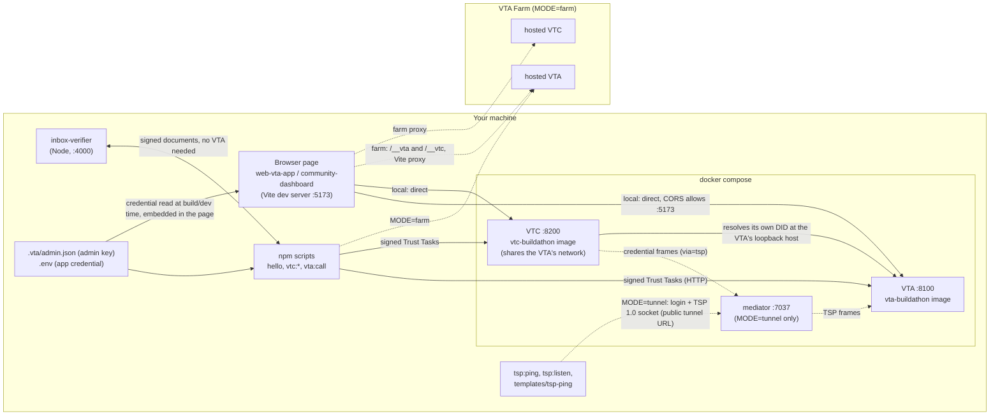

# Architecture and code tour

How the pieces fit, where things live, and how to extend them. Everything here is a playground: see [SECURITY.md](SECURITY.md).

## Layout

| Path | What it does |
|---|---|
| `packages/vta-client` | `VtaClient`: reads the VTA's DID, authenticates (`auth/challenge` then `auth/authenticate`), signs and POSTs any Trust Task (`call`), typed helpers (`discover`, `whoami`, `createContext`, `grantAcl`). `identity.ts` makes did:key identities and encodes the credential. Node and browser. |
| `packages/vtc-client` | `VtcClient`: the same for a community: join manifest, join, status, withdraw, member helpers (card, directory, renew, leave, groups, `memberProof()`), admin list/decide. `onCall` reports every call (used by the dashboard). |
| `packages/tsp-client` | `tspPing` and `connectTsp`: log in to the mediator with a `did:key`, open the raw-TSP socket, send a signed `messaging/ping/0.1` and read the pong, or receive frames (the VTC's credential pushes). Packs TSP 1.0 on `pnm-core`'s login and socket helpers (`MODE=tunnel`). Node and browser. |
| `packages/status-panel` | `mountStatusPanel(el, opts)`: reachability, DID services, version vs pin, session, capabilities. Plain TypeScript, no dependencies. |
| `templates/inbox-verifier` | Node server that accepts signed documents and applies the consumer checks (recipient, freshness, proof, schema, replay). `src/inbox.ts` is the place to start. Works offline. |
| `templates/web-vta-app` | Browser app: the status panel plus an optional wallet panel. Vanilla TypeScript, Vite. |
| `templates/community-dashboard` | React + Vite dashboard for the VTC member journey. `state.ts` maps signed-call results to a screen; `components/` renders it. |
| `templates/tsp-ping` | Browser page that sends the TSP ping and shows the pong (Vite, port 3000; `MODE=tunnel`). |
| `templates/mcp-agent` | Stub: provisions a scoped identity and writes an MCP host config. Not verified end to end. |
| `scripts/` | The npm commands. `env.ts` (`.env` and admin key files), `up.ts`, `keygen.ts`, `provision.ts`, `hello.ts`, `call.ts`, `vtc-*.ts`, `farm-*.ts`, `images-build.ts`, `pins*.ts`, `banner.ts`, `tunnel-probe.ts`, `tsp-ping*.ts`, `tsp-listen.ts`, `approvals-*.ts`, `approver.ts`, the live tests `test-roles.ts` and `e2e.ts`, and the checks `check-generic.ts`, `check-docs.ts`, `security-check.ts`. `scripts/lib/` has the shared helpers (tunnels, compose, approvals, the CDP browser driver). |
| `docker-compose.yml`, `vta-entrypoint.sh`, `vtc-entrypoint.sh`, `mediator-entrypoint.sh`, `docker/` | The local VTA (always), VTC (compose profile `vtc`) and, for `MODE=tunnel`, redis and the mediator (profile `messaging`); `docker/` holds the VTC and mediator Dockerfiles. |
| `pins.json`, `PINS_LOG.md` | The versions this kit was validated against ([PINS.md](PINS.md)). |

## What talks to what

- **Status panel** is rendered inside `web-vta-app` and in the dashboard's "connection" drawer; it reads `/health`, the DID log and (with a credential) the session details.
- **Vite proxy**: in farm mode the hosted agent does not allow `http://localhost:5173` in CORS, so each template's `vite.config.ts` proxies `/__vta` and `/__vtc` and the page stays same-origin. In local mode the page calls the containers directly.
- **Tunnel mode** (`MODE=tunnel`, [MODES.md](MODES.md)) runs the same containers plus redis and a mediator, and three `cloudflared` processes on the host that give the VTA, VTC and mediator public hostnames. `up` starts the tunnels first because the DIDs and configs name those hostnames. The browser and the scripts then talk to the public URLs instead of `localhost`.
- **The VTC shares the VTA container's network namespace** so the VTA's `localhost:8100` DID is reachable from the VTC; that is why the VTC port is published on the VTA service.
- The `inbox-verifier` is independent: a `did:key` carries its own public key, so a document can be verified with no network.

## Identities and credentials

1. `npm run vta:keygen` makes an **admin** Ed25519 `did:key` and writes the private key to `.vta/admin.json` (mode 0600) and the public DID to `.vta/admin.env`. Compose passes the DID to the VTA, which seeds it as super-admin on first boot (`vta-entrypoint.sh`).
2. `npm run vta:provision` signs in as the admin, creates the context (default `my-app`), generates a fresh **app** `did:key`, grants it the `application` role scoped to that context, and writes `.env`: `VTA_URL`, `VTA_DID`, `VTA_CONTEXT`, `APP_DID` and `VTA_CREDENTIAL` (a base64 bundle containing the app's private key). It is idempotent; `ENV_FILE=.env.other` keeps several identities.
3. `VtaClient.fromCredential(...)` / `VtcClient.connect(...)` sign every request with that key. A Trust Task is a JSON document with `id`, `type`, `issuer`, `recipient`, `issuedAt` and `payload`, plus a Data Integrity proof.
4. The VTA's own seed is a plaintext file on its Docker volume (`vta-data`). `npm run vta:reset` deletes the volumes, `.vta/` and `.env`.
5. A VTC member is the same app DID after a join request is approved. Members are sessionless: they sign each request; there is no console session for them ([VTC.md](VTC.md), [VTC-SURFACE.md](VTC-SURFACE.md)).

## Pins and image build

`pins.json` records the upstream release (VTA and VTC come from different commits) and exact npm versions. `npm run images:build [vta|vtc|mediator|all]` builds each image from its own pinned ref of a local checkout of the upstream repository (`VTI_PATH`), tagging `<image>:<short-sha>` and `:local`, the default in compose. `npm run pins:check` reports drift. See [PINS.md](PINS.md). Building an image from source is slow (Rust), and no images are published: see [PINS.md](PINS.md#where-the-images-come-from) for the exact cold path.

## Framework-free and React

- Framework-free TypeScript: `vta-client`, `vtc-client`, `status-panel`, `inbox-verifier`, `web-vta-app`, all scripts.
- React 18 (with `@vitejs/plugin-react`): only `templates/community-dashboard`. Its logic is kept out of components on purpose: `state.ts`, `criteria.ts`, `format.ts`, `poll.ts` are plain modules with unit tests; `hooks.ts` and `components/` are the React layer; the status panel is mounted from a small React wrapper.

## Tests

`npm test` runs, in order: `check:generic` (no personal specifics in the tree), `check:docs` (links and script names), `scripts/test/*.test.ts`, then every workspace's own tests. Tests use Node's built-in runner through `tsx --test`:

| Where | Covers |
|---|---|
| `scripts/test/` | Farm host selection, banner, role matrix and docs parity, personas, recipes, security check, tunnel helpers, approvals |
| `packages/vta-client/test`, `packages/vtc-client/test` | Signing, credentials, client behaviour with a fake `fetch` |
| `packages/status-panel/test` | Parsing of probe results |
| `templates/inbox-verifier/test` | Accept, replay, tamper, wrong recipient, malformed |
| `templates/community-dashboard/test` | State mapping, criteria, formatting, polling; `test/ui` component tests against a fake community (Vitest, jsdom) |

None of them needs a running VTA. `npm run typecheck` runs `tsc` in the root and every workspace.

## How to extend

- **Call a task you have not used**: `npm run vta:call -- <slug> '<json>'`, then wrap it in a typed helper if you reuse it. Find schemas at `https://trusttasks.org/spec/<slug>`; see [trust-tasks/](trust-tasks/README.md).
- **Your own task**: change `NOTE_TYPE`, the schema and handler in `templates/inbox-verifier/src/inbox.ts` ([trust-tasks/04-developing-tasks.md](trust-tasks/04-developing-tasks.md)).
- **A new template**: add a folder under `templates/` with a `package.json` named `@buildathon/<name>` (workspaces pick it up), depend on `@buildathon/vta-client`, and read the credential as `web-vta-app` does. Add its scripts to the docs; `npm run check:docs` will catch a mistyped one.
- **A new command**: add `scripts/<name>.ts`, an entry in the root `package.json`, call `devBanner()` from `scripts/banner.ts` if it creates keys.
- **A new pin**: edit `pins.json`, run `npm run pins:check`, note it in `PINS_LOG.md`.
